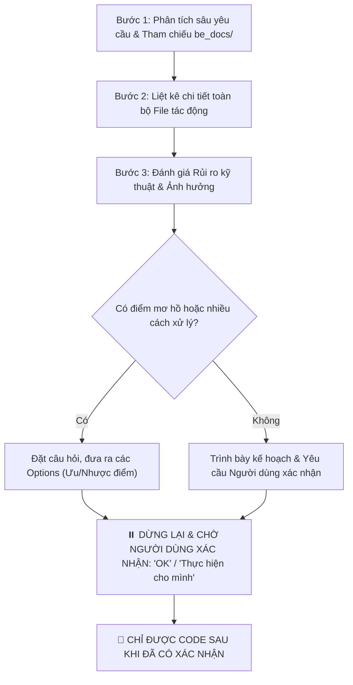

# 🤖 HƯỚNG DẪN HOẠT ĐỘNG DÀNH CHO AI AGENT (AGENTS OPERATING MANUAL)
## Dự án: Restaurant Management & Online Food Ordering Backend (Laravel 11)

> **QUY TẮC BẮT BUỘC (CRITICAL DIRECTIVE):**  
> Mọi AI Agent (Antigravity, Claude, Cursor, Copilot, v.v.) khi làm việc trong repository này **BẮT BUỘC** phải tuân thủ nghiêm ngặt toàn bộ các quy trình, nguyên tắc và điều kiện xác nhận được quy định dưới đây. Tuyệt đối không được bỏ qua bất kỳ bước nào.

---

## 🛑 1. QUY TRÌNH 4 BƯỚC BẮT BUỘC TRƯỚC KHI THỰC THI (MANDATORY WORKFLOW)

Trước khi chỉnh sửa, tạo mới hoặc xóa bất kỳ file mã nguồn nào, Agent **PHẢI** thực hiện đầy đủ 4 bước tuần tự sau:



---

### BƯỚC 1: Phân Tích Chuyên Sâu (In-depth Analysis)
- Đọc và tra cứu kỹ các tài liệu đặc tả nghiệp vụ tương ứng trong thư mục `be_docs/` trước khi bắt đầu:
  1. [`be_docs/system_conventions.md`](be_docs/system_conventions.md): Quy ước hệ thống cốt lõi, 7 Enums, Redis keys, Soft Delete và Pivot rules.
  2. [`be_docs/api_protocol_specification.md`](be_docs/api_protocol_specification.md): Quy ước Response Envelopes, mã lỗi HTTP và định dạng JSON chuẩn.
  3. [`be_docs/modules/`](be_docs/modules/): Đặc tả nghiệp vụ chuyên sâu, Use Cases, FSM, validation rules, luồng thực thi và thuật toán từng module (`auth.md`, `menu.md`, `order.md`...).
  4. [`be_docs/modules.md`](be_docs/modules.md): Ranh giới Module, danh sách API và tiến độ của từng module.
  5. [`be_docs/glossary_and_laravel_eloquent_mapping.md`](be_docs/glossary_and_laravel_eloquent_mapping.md): 12 Models Eloquent, quan hệ nhiều-nhiều, Backed Enums.
- Phân tích rõ mục tiêu cần đạt, luồng dữ liệu (Request $\rightarrow$ Route $\rightarrow$ Middleware $\rightarrow$ FormRequest $\rightarrow$ Controller $\rightarrow$ Service $\rightarrow$ Model $\rightarrow$ Resource $\rightarrow$ Response).

---

### BƯỚC 2: Liệt Kê Danh Sách File Tác Động (Impact Analysis)
Agent phải liệt kê tường minh và phân loại toàn bộ các file sẽ bị ảnh hưởng:
- **File tạo mới:** Đường dẫn tuyệt đối / tương đối của file mới.
- **File chỉnh sửa:** Tên file, các hàm / phương thức sẽ thay đổi.
- **File di chuyển / Xóa bỏ:** (Nếu có).
- **Phân loại tầng kiến trúc:** Đánh dấu rõ file thuộc tầng nào: `Controller`, `Service`, `Model`, `Request`, `Resource`, `Route`, `Migration`, hoặc `Config`.

---

### BƯỚC 3: Đánh Giá Rủi Ro Kỹ Thuật (Risk Assessment)
Agent phải tự trả lời và trình bày rõ các câu hỏi rủi ro:
1. **Rủi ro API Contract (Ảnh hưởng Frontend):** Thay đổi này có làm đổi tên trường (keys), cấu trúc JSON Envelope, hoặc mã HTTP Status Code không? (Frontend có bị gãy không?)
2. **Rủi ro Dữ liệu & Database:** Có nguy cơ vi phạm ràng buộc toàn vẹn khóa ngoại (Foreign Key), mất dữ liệu lịch sử hoặc lỗi Migration không?
3. **Rủi ro Concurrency / Race Condition:** Thao tác này có bị ảnh hưởng khi nhiều người dùng cùng bấm đồng thời không? (Cần dùng `Cache::lock()` hay `DB::transaction()` không?)
4. **Rủi ro Hiệu năng & Cache:** Dữ liệu có bị stale cache không? Cần cơ chế Cache Busting (`Cache::forget`) ở đâu?
5. **Rủi ro Namespace / Autoload:** Khi di chuyển file sang Module, có nguy cơ lỗi class not found không?

---

### BƯỚC 4: Quy Tắc "Không Đoán Mò – Hỏi & Chờ Xác Nhận" (Strict Confirmation Policy)

> [!CAUTION]
> **TUYỆT ĐỐI CẤM ĐOÁN MÒ (NO GUESSWORK):**
> - Không được tự ý suy diễn nghiệp vụ khi yêu cầu chưa nêu rõ.
> - Không tự ý chọn một thư viện/cách làm khi có nhiều giải pháp tương đương mà chưa hỏi ý kiến.
> - Không được vừa phân tích vừa tự ý sửa code luôn trong cùng một lượt khi chưa có sự đồng ý của người dùng.

**Nhiệm vụ của Agent:**
1. Đặt câu hỏi rõ ràng, giải thích ngắn gọn bản chất vấn đề.
2. Đưa ra các phương án khả thi kèm **Ưu điểm / Nhược điểm** của từng phương án (Option A vs. Option B).
3. Đề xuất phương án khuyến nghị (nếu có lý do kỹ thuật chính đáng).
4. **DỪNG LẠI VÀ YÊU CẦU XÁC NHẬN:**  
   Chờ người dùng trả lời hoặc xác nhận bằng các cụm từ như:
   - *"OK"*
   - *"Thực hiện cho mình"*
   - *"Tiến hành đi"*
   - Hoặc người dùng chọn cụ thể một phương án.
5. **CHỈ BẮT ĐẦU CHỈNH SỬA CODE SAU KHI ĐÃ NHẬN ĐƯỢC XÁC NHẬN NÀY!**

---

## 📋 2. MẪU TRÌNH BÀY CHUẨN CỦA AGENT (PRE-EXECUTION PROPOSAL TEMPLATE)

Khi người dùng đưa ra một yêu cầu mới liên quan đến code/refactor, Agent **BẮT BUỘC** phản hồi theo mẫu cấu trúc sau trước khi thực hiện:

```markdown
### 1. Phân tích Yêu cầu & Mục tiêu Kỹ thuật
- [Tóm tắt ngắn gọn yêu cầu nghiệp vụ và mục tiêu cần giải quyết]

### 2. Danh sách các File sẽ Tác động
- **Tạo mới:** `path/to/NewFile.php`
- **Chỉnh sửa:** `path/to/ExistingFile.php` (phương thức: `methodName`)
- **Di chuyển/Xóa:** (nếu có)

### 3. Đánh giá Rủi ro Kỹ thuật & Giải pháp Phòng ngừa
- **Rủi ro API/Frontend:** [Có/Không ảnh hưởng đến cấu trúc JSON response]
- **Rủi ro Database:** [Có/Không ảnh hưởng đến schema hoặc foreign keys]
- **Rủi ro Concurrency:** [Có cần Redis Lock hoặc Database Transaction không]

### 4. Các Phương án Xử lý & Câu hỏi Cần Làm Rõ (nếu có)
- **Phương án 1 (Khuyến nghị):** ... (Ưu: ..., Nhược: ...)
- **Phương án 2:** ... (Ưu: ..., Nhược: ...)

👉 **Bạn có đồng ý với kế hoạch trên không? Vui lòng phản hồi hoặc xác nhận "OK / Thực hiện cho mình" để tôi bắt đầu triển khai code.**
```

---

## 🔒 3. CÁC NGUYÊN TẮC KỸ THUẬT BẤT DI BẤT DỊCH (IMMUTABLE TECHNICAL RULES)

1. **Pure RESTful Backend Service:**
   - Tuyệt đối không can thiệp, không tạo file và không viết logic vào `resources/views`, `resources/css`, `resources/js`, `vite.config.js` hoặc `routes/web.php`.
2. **Unified Response Envelope:**
   - Mọi Controller API phải sử dụng `ApiResponse` Trait (`$this->successResponse(...)`, `$this->errorResponse(...)`).
   - Tuyệt đối không trả về raw array hoặc tự chế cấu trúc JSON khác làm vỡ chuẩn của Frontend.
3. **Quy tắc Xóa mềm (Soft Delete Policy):**
   - Tuyệt đối **không gọi lệnh `$dish->delete()` vật lý** trên bảng món ăn `MON_AN` vì sẽ vi phạm ràng buộc khóa ngoại trong `CHI_TIET_DON_HANG`.
   - Luôn sử dụng cờ xóa mềm `da_xoa = true` và `hien_thi = false`.
4. **Quy tắc Bảo mật Tài khoản (Rule AUTH-LOCK):**
   - Model `Account` luôn bật thuộc tính `protected $hidden = ['mat_khau'];`.
   - Admin không bao giờ được phép tự khóa tài khoản của chính mình.
   - Khi khóa tài khoản, phải lập tức gọi `$account->tokens()->delete()` để thu hồi phiên làm việc tức thì.
5. **Cơ chế Khóa Phân Tán (Redis Lock Pattern):**
   - Khi áp dụng `Cache::lock()`, phải luôn giải phóng trong khối `finally` hoặc sử dụng hàm callback `block($seconds, closure)` để tránh tình trạng Deadlock vĩnh viễn nếu logic bên trong gặp lỗi.

---

## 🧠 4. QUY TẮC TỰ ĐỘNG GHI NHỚ (AUTO-MEMORY SYSTEM)

Agent có quyền và nghĩa vụ cập nhật bộ nhớ dài hạn của dự án tại thư mục `be_docs/memory/`:
1. **Sau khi xử lý xong một bug khó hoặc lỗi môi trường:**
   - Tự động ghi lại một mục mới vào [`be_docs/memory/lessons-learned.md`](be_docs/memory/lessons-learned.md) theo chuẩn:  
     `[Lỗi gặp phải] -> [Nguyên nhân cốt lõi] -> [Giải pháp xử lý triệt để]`.
2. **Sau khi thống nhất một quyết định kiến trúc hoặc logic lớn với người dùng:**
   - Tạo mã quyết định mới (`ADR-023`, `ADR-024`...) trong [`be_docs/memory/architectural-decisions.md`](be_docs/memory/architectural-decisions.md).
3. **Sau khi hoàn thành hoặc cập nhật tiến độ của một Module:**
   - Đồng bộ lại bảng tiến độ trong [`be_docs/modules.md`](be_docs/modules.md).
4. **Trước khi bắt đầu bất kỳ task code nào:**
   - Bắt buộc kiểm tra thư mục `be_docs/memory/` để không lặp lại sai lầm trong quá khứ và tuân thủ đúng lộ trình kiến trúc đã định.
