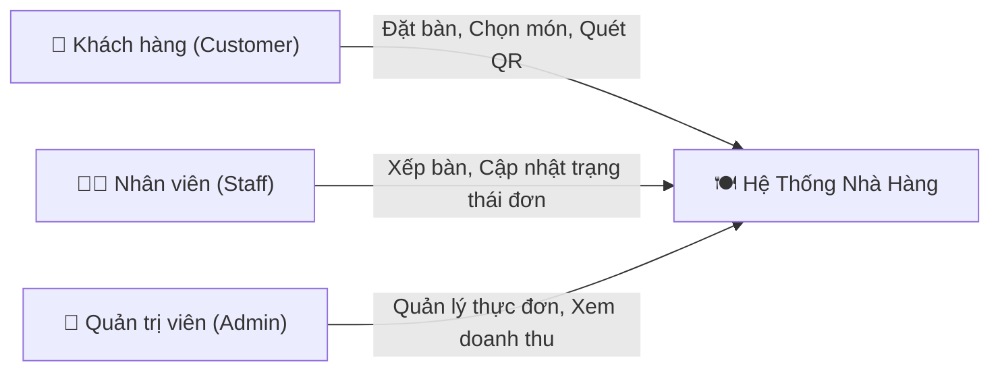
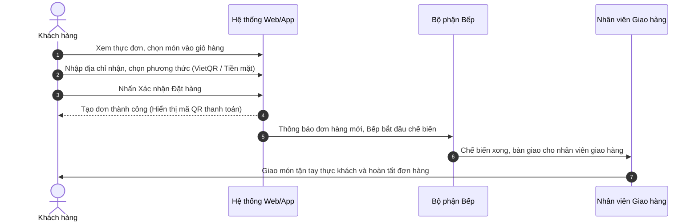
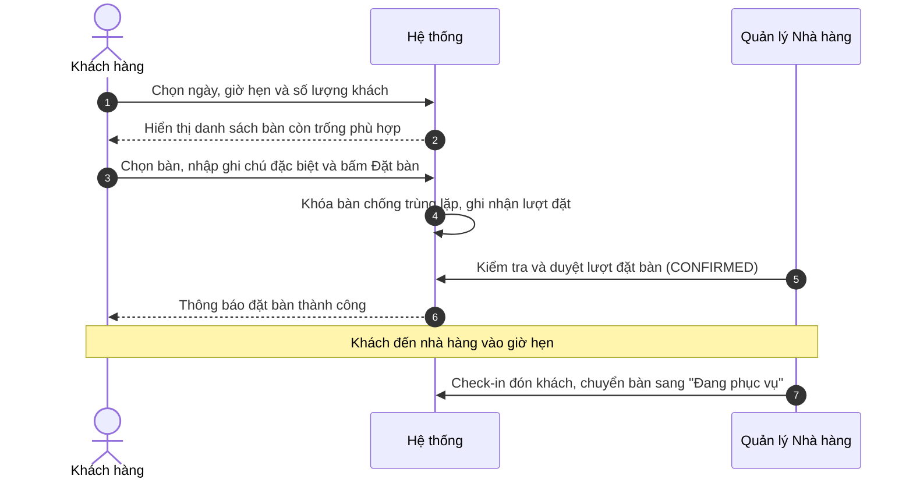

# 🍽️ TỔNG QUAN HỆ THỐNG QUẢN LÝ NHÀ HÀNG & ĐẶT MÓN ĂN TRỰC TUYẾN
## (Restaurant Management & Online Dining Platform)

> **Tài liệu dành cho Khách hàng, Đối tác kinh doanh và Người dùng hệ thống**  
> Bản mô tả chi tiết mục tiêu, giá trị sử dụng, các tính năng nghiệp vụ và quy trình trải nghiệm của giải pháp ẩm thực toàn diện.

---

## 🌟 1. Giới thiệu Dự án (System Overview)

Hệ thống **Quản lý Nhà hàng & Đặt món ăn trực tuyến** là một nền tảng chuyển đổi số toàn diện dành cho ngành F&B (Food and Beverage). Dự án được xây dựng nhằm thu hẹp khoảng cách giữa khách hàng ẩm thực và đội ngũ vận hành nhà hàng thông qua trải nghiệm dịch vụ tiện lợi, thông minh và nhanh chóng.

Thay vì phải gọi điện đặt bàn thủ công hoặc ghi chép đơn hàng bằng giấy bút dễ sai sót, hệ thống mang đến một không gian số hóa đồng bộ:
- **Khách hàng:** Có thể xem thực đơn phong phú, nhận gợi ý món ăn theo thời tiết thực tế, chủ động đặt bàn giữ chỗ từ sớm và thanh toán tiện lợi bằng mã VietQR hoặc tiền mặt.
- **Nhà hàng:** Quản lý quy trình phục vụ từ khâu tiếp nhận đơn hàng, điều phối bếp chế biến, bố trí chỗ ngồi tại bàn ăn đến thống kê doanh thu và món ăn bán chạy trong ngày một cách chính xác theo thời gian thực.

---

## 👥 2. Đối tượng Người dùng & Vai trò (User Roles)

Hệ thống được thiết kế hướng tới 3 nhóm người dùng chính với quyền hạn và trải nghiệm riêng biệt:

| Vai trò | Tên gọi | Mô tả vai trò & Trách nhiệm chính |
| :--- | :--- | :--- |
| **Khách hàng** | `CUSTOMER` | Khách ẩm thực đăng ký tài khoản để khám phá thực đơn, đặt món ăn giao tận nơi/nhận tại chỗ, đặt bàn ăn trước, theo dõi đơn hàng và thanh toán. |
| **Nhân viên** | `STAFF` | Đội ngũ phục vụ và thu ngân: tiếp nhận và chuyển trạng thái đơn hàng (đang chuẩn bị, đang giao, hoàn thành), xếp khách vào bàn ăn, xác nhận thanh toán tiền mặt. |
| **Quản trị viên** | `ADMIN` | Chủ nhà hàng hoặc người quản lý: kiểm soát toàn bộ danh mục thực đơn, điều chỉnh giá bán và tình trạng món ăn, quản trị tài khoản nhân viên, xem báo cáo thống kê doanh thu và hiệu suất hoạt động. |

---

## 💎 3. Điểm nhấn & Giá trị Nổi bật (Key Highlights)

### 🌤️ 1. Gợi ý món ăn thông minh theo Thời tiết thực tế (Weather-based Recommendation)
- Hệ thống tự động nhận diện thời tiết tại khu vực của thực khách (nắng nóng, mưa lạnh hoặc mát mẻ) để gợi ý các món ăn phù hợp nhất (ví dụ: ngày nắng ưu tiên nước mát giải nhiệt, ngày lạnh gợi ý món lẩu, súp ấm bụng).
- **Tự động lọc dị ứng:** Khách hàng có thể lưu thông tin dị ứng (hải sản, đậu phộng, gluten...). Hệ thống sẽ tự động ẩn các món gây nguy cơ dị ứng để bảo vệ tối đa sức khỏe người dùng.

### 🪑 2. Đặt bàn thông minh – Chống trùng lặp tuyệt đối
- Khách hàng có thể kiểm tra danh sách bàn còn trống theo đúng ngày, giờ hẹn và số lượng người đi cùng.
- Công nghệ khóa giữ chỗ tự động giúp ngăn chặn triệt để tình trạng hai khách hàng đặt trùng cùng một bàn trong cùng một khung giờ.
- Hỗ trợ ghi chú yêu cầu đặc biệt (tiệc sinh nhật, bàn ngoài trời, chuẩn bị nến/hoa...).

### 💳 3. Thanh toán Hiện đại với VietQR Chuẩn Quốc gia
- Bên cạnh phương thức tiền mặt truyền thống, hệ thống tích hợp sẵn mã thanh toán **VietQR động** chuẩn Napas 247.
- Khách hàng chỉ cần mở ứng dụng ngân hàng bất kỳ trên điện thoại để quét mã: tiền và nội dung chuyển khoản được điền tự động chính xác, không lo gõ nhầm số tài khoản hay số tiền.

### ⚡ 4. Vận hành Nhanh, Không trễ, Không nghẽn mạng
- Áp dụng công nghệ lưu nhớ tức thời (In-Memory Caching) giúp thực đơn và các trang thông tin tải ngay tức thì dù có hàng nghìn lượt truy cập cùng lúc.

---

## 📱 4. Các Phân hệ & Tính năng Nghiệp vụ

### Phân hệ 1: Trải nghiệm Thực khách (Customer Portal)
1. **Quản lý Tài khoản & Hồ sơ:**
   - Đăng ký, đăng nhập an toàn, bảo mật thông tin cá nhân.
   - Quản lý sổ địa chỉ giao hàng và danh sách chất dị ứng cá nhân.
   - Đổi mật khẩu định kỳ để nâng cao tính an toàn.
2. **Khám phá Thực đơn:**
   - Xem món ăn theo từng danh mục (Khai vị, Món chính, Tráng miệng, Đồ uống...).
   - Tìm kiếm nhanh món ăn theo từ khóa tên món.
   - Bộ lọc tiện lợi: lọc theo khoảng giá tiền, tình trạng còn bán hay đã hết, loại bỏ chất dị ứng.
   - Xem chi tiết món ăn: ảnh minh họa, giá bán, mô tả nguyên liệu, thành phần dinh dưỡng.
3. **Giỏ hàng & Đặt món:**
   - Thêm món, điều chỉnh số lượng hoặc xóa món trong giỏ hàng một cách mượt mà.
   - Chọn hình thức nhận món: **Giao hàng tận nơi** (Delivery) hoặc **Đến lấy tại quán** (Pickup).
   - Chốt đơn hàng an toàn với đơn giá cố định tại thời điểm đặt.
4. **Đặt bàn trước (Table Reservation):**
   - Tìm kiếm bàn ăn có sức chứa phù hợp với đoàn khách.
   - Đặt bàn trước giờ hẹn, theo dõi trạng thái duyệt bàn từ phía nhà hàng.
   - Chủ động hủy hoặc sửa lịch đặt bàn trước tối thiểu 60 phút.

### Phân hệ 2: Vận hành & Phục vụ (Staff Operations)
1. **Xử lý Đơn đặt món:**
   - Tiếp nhận đơn hàng mới ngay khi khách đặt.
   - Cập nhật quy trình đơn hàng: Chờ xác nhận $\rightarrow$ Đang chế biến $\rightarrow$ Đang giao $\rightarrow$ Hoàn thành.
2. **Quản lý Bàn ăn & Đón khách:**
   - Sơ đồ bàn trực quan thể hiện rõ bàn nào đang trống, bàn nào đã được đặt trước hoặc bàn đang có khách ngồi.
   - Tiếp đón khách đặt trước, chuyển bàn sang trạng thái "Đang phục vụ", giải phóng bàn về "Trống" sau khi khách dùng bữa xong.
3. **Xác nhận Thu ngân:**
   - Đối soát giao dịch chuyển khoản hoặc xác nhận đã thu tiền mặt tại quầy.

### Phân hệ 3: Quản trị Doanh nghiệp (Admin Management)
1. **Quản lý Thực đơn & Bảng giá:**
   - Thêm danh mục món ăn mới, thay đổi thứ tự ưu tiên hiển thị.
   - Thêm món ăn mới kèm hình ảnh, gắn thẻ thời tiết (`HOT_SUNNY`, `RAINY_OR_COLD`), khai báo danh sách chất gây dị ứng.
   - Ẩn/Hiện món ăn linh hoạt khi tạm thời hết nguyên liệu; xóa mềm an toàn không làm mất lịch sử bán hàng.
2. **Quản lý Nhân sự & Khách hàng:**
   - Danh sách tài khoản người dùng có phân quyền rõ ràng (`ADMIN`, `STAFF`, `CUSTOMER`).
   - Tạo mới tài khoản nhân viên phục vụ.
   - Khóa hoặc kích hoạt lại tài khoản khi có sự cố.
3. **Báo cáo Thống kê & Dashboard Tổng quan:**
   - **Doanh thu:** Biểu đồ doanh thu theo chuỗi ngày, so sánh các mốc thời gian.
   - **Đơn hàng:** Thống kê tổng số đơn, đơn hoàn tất, đơn bị hủy và tỷ lệ hoàn thành.
   - **Món ăn bán chạy:** Top các món được gọi nhiều nhất giúp nhà hàng dự trù nhập nguyên liệu hợp lý.
   - **Hiệu suất lấp đầy bàn:** Đo lường tỷ lệ sử dụng bàn ăn để tối ưu hóa không gian tiếp khách.

---

## 🔄 5. Quy trình Trải nghiệm Tiêu biểu (User Journeys)

### Quy trình A: Đặt món ăn giao tận nơi

### Quy trình B: Đặt bàn ăn trước tại nhà hàng

---

## 🛡️ 6. Cam kết về Độ tin cậy & An toàn Thông tin

- **Bảo mật tuyệt đối:** Mọi mật khẩu của khách hàng và nhân viên đều được mã hóa theo tiêu chuẩn công nghiệp (BCrypt đa lớp), không thể bị đọc lén.
- **Tính toán tài chính chính xác:** Tiền hàng, tiền cọc và lịch sử giao dịch được bảo vệ bằng các ràng buộc cơ sở dữ liệu nghiêm ngặt, loại bỏ hoàn toàn nguy cơ sai lệch số liệu.
- **Sẵn sàng hoạt động 24/7:** Kiến trúc hệ thống hiện đại, dễ dàng bảo trì và cập nhật tính năng mới mà không làm gián đoạn trải nghiệm của người dùng.

---

*Hệ thống Quản lý Nhà hàng & Đặt món trực tuyến cam kết mang lại giải pháp F&B chuyên nghiệp, tiện nghi và hiện đại bậc nhất!*

