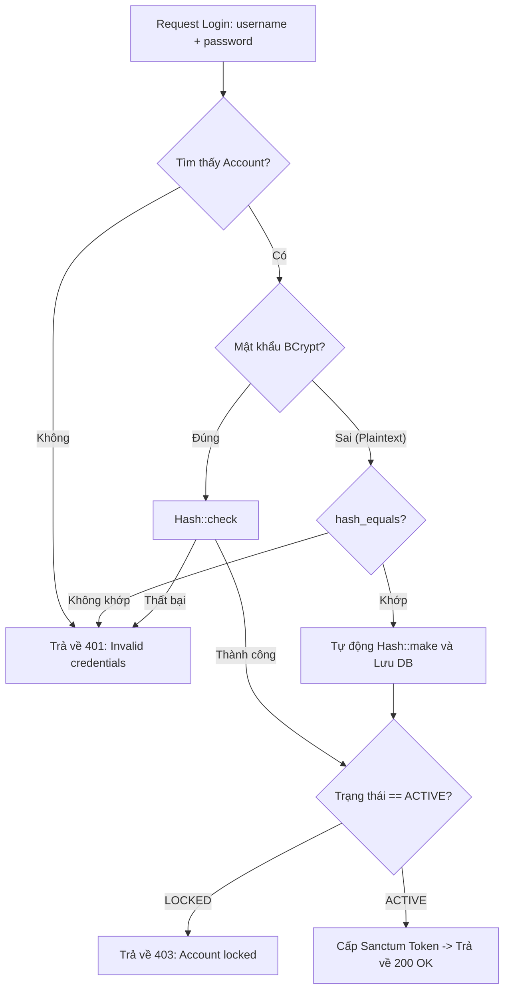

# 🛡️ MODULE: AUTH – Business Logic & API Spec

> **Vị trí thư mục:** `app/Modules/Auth/`  
> **Namespace:** `App\Modules\Auth\`  
> **Phiên bản:** 2.0 (Streamlined Edition)

---

## 1. Tổng quan & Trách nhiệm

Module **Auth** chịu trách nhiệm quản lý toàn bộ vòng đời tài khoản và danh tính trong hệ thống nhà hàng:
- **Xác thực:** Đăng ký tài khoản khách hàng, đăng nhập hệ thống, đăng xuất; cấp phát và thu hồi Sanctum Personal Access Token.
- **Hồ sơ cá nhân:** Khách hàng tra cứu và cập nhật thông tin cá nhân, sổ địa chỉ nhận hàng, thiết lập cảnh báo dị ứng thực phẩm và sở thích ăn uống.
- **Quản trị tài khoản:** Admin phân trang, tìm kiếm tài khoản theo vai trò/trạng thái; tạo tài khoản nhân viên; khóa/mở khóa tài khoản.
- **Phân quyền RBAC:** Kiểm soát quyền truy cập qua vai trò (`ADMIN`, `STAFF`, `CUSTOMER`) bằng Middleware `CheckRole`.
- **Bảo mật mật khẩu:** Tự động nâng cấp mật khẩu legacy plaintext (`'123'`) từ seed mẫu sang chuẩn băm `BCrypt` an toàn khi đăng nhập.

---

## 2. Thành phần kỹ thuật

| Thành phần | Tên lớp / Đường dẫn file thực tế | Trách nhiệm |
| :--- | :--- | :--- |
| **Models** | `Account` (`TAI_KHOAN`)<br>`UserProfile` (`NGUOI_DUNG`)<br>`Role` (`VAI_TRO`) | Quản lý tài khoản đăng nhập (ẩn `mat_khau`), thông tin cá nhân và vai trò hệ thống. |
| **Services** | `AuthService`<br>`Customer\ProfileService`<br>`Admin\AccountService` | Xử lý transaction đăng ký/đăng nhập, cập nhật hồ sơ, quản trị tài khoản và Rule `AUTH-LOCK`. |
| **Controllers** | `AuthController`<br>`Customer\ProfileController`<br>`Admin\AccountController` | Tiếp nhận request, gọi Service và trả về qua `ApiResponse`. |
| **FormRequests** | `RegisterRequest`, `LoginRequest`<br>`Customer\UpdateProfileRequest` | Kiểm thực dữ liệu đầu vào. |
| **Resources** | `AccountResource`, `UserProfileResource`<br>`CustomerProfileResource`, `AdminAccountResource` | Định dạng dữ liệu đầu ra chuẩn JSON cho Frontend. |
| **Routes** | `app/Modules/Auth/Routes/api.php` | Định tuyến `/api/v1/auth/*`, `/api/v1/customer/*`, `/api/v1/admin/accounts/*`. |

---

## 3. Domain Rules Bất Biến

### 3.1. Rule AUTH-LOCK (Khóa Tài Khoản & Thu Hồi Token Tức Thì)
- Admin **tuyệt đối không được tự khóa chính mình** (`target->ma_tai_khoan !== admin->ma_tai_khoan`).
- Khi khóa tài khoản (`trang_thai = LOCKED`), lập tức thực thi:
  ```php
  $targetAccount->tokens()->delete(); // Thu hồi 100% Sanctum Token, ép logout ngay lập tức
  ```

### 3.2. Rule BCrypt Auto-Upgrade (Nâng Cấp Mật Khẩu Dữ Liệu Mẫu)
Khi đăng nhập `USR-02`, hỗ trợ tài khoản seed có mật khẩu `'123'`:
- Nếu bắt đầu bằng `$2y$` $\rightarrow$ `Hash::check($plain, $stored)`.
- Nếu là chuỗi thường $\rightarrow$ so khớp `hash_equals($stored, $plain)`, nếu đúng thì nâng cấp:
  ```php
  $account->mat_khau = Hash::make($plainPassword);
  $account->save();
  ```

### 3.3. Rule Ẩn Mật Khẩu
Model `Account` luôn bật thuộc tính `protected $hidden = ['mat_khau'];`. 100% API không bao giờ để lộ trường mật khẩu ra ngoài.

---

## 4. Schemas Dữ Liệu Chuẩn Dành Cho Frontend

### Schema 4.1: Hồ sơ Khách hàng (`UserProfileResource`)
```json
{
  "userId": 1,
  "fullName": "Nguyễn Văn A",
  "phoneNumber": "0901234567",
  "birthDate": "1995-08-15",
  "defaultAddress": "123 Lê Duẩn, P. Bến Nghé, Quận 1, TP.HCM",
  "savedAddresses": [
    { "label": "Văn phòng", "address": "456 Nguyễn Thị Minh Khai, Q.3", "isDefault": false }
  ],
  "allergies": ["SHELLFISH", "PEANUT"],
  "dietaryPreferences": ["LESS_SUGAR"],
  "username": "customer1",
  "role": "CUSTOMER"
}
```

### Schema 4.2: Chi tiết Tài khoản Quản trị (`AdminAccountResource`)
```json
{
  "accountId": 2,
  "username": "staff1",
  "status": "ACTIVE",
  "createdAt": "2026-11-01 08:00:00",
  "role": { "roleId": 2, "roleCode": "STAFF", "roleName": "Nhân viên phục vụ" },
  "userProfile": { "fullName": "Trần Thị B", "phoneNumber": "0912345678", "birthDate": "1998-05-20" }
}
```

---

## 5. Bảng Tổng Hợp Endpoints CRUD Chuẩn

| Mã API | Method | Endpoint URL | Phân quyền | Body Request | Response Payload | Mã HTTP |
| :---: | :---: | :--- | :---: | :--- | :--- | :---: |
| `USR-03` | `POST` | `/api/v1/auth/logout` | `auth:sanctum` | *(Không)* | `{ "message": "Logged out successfully" }` | `200` |
| `USR-04` | `GET` | `/api/v1/customer/profile` | `CUSTOMER` | *(Không)* | `UserProfileResource` (Schema 4.1) | `200` |
| `USR-05` | `PUT` | `/api/v1/customer/profile` | `CUSTOMER` | `{ "fullName", "phoneNumber", "birthDate", "savedAddresses", "allergies", "dietaryPreferences" }` | `UserProfileResource` đã cập nhật | `200` |
| `USR-06` | `PUT` | `/api/v1/customer/password` | `CUSTOMER` | `{ "currentPassword", "newPassword", "newPassword_confirmation" }` | `{ "message": "Password changed successfully" }` (Thu hồi toàn bộ token cũ) | `200` |
| `ADM-01` | `GET` | `/api/v1/admin/accounts` | `ADMIN` | Query: `page`, `perPage`, `search`, `role`, `status` | Paginated `[AdminAccountResource]` | `200` |
| `ADM-02` | `GET` | `/api/v1/admin/accounts/{id}` | `ADMIN` | *(Không)* | `AdminAccountResource` (Schema 4.2) | `200 / 404` |
| `ADM-03` | `POST` | `/api/v1/admin/accounts/staff` | `ADMIN` | `{ "username", "password", "password_confirmation", "fullName", "phoneNumber", "birthDate"? }` | `201`: `AdminAccountResource` nhân viên mới | `201 / 422` |
| `ADM-04` | `PUT` | `/api/v1/admin/accounts/{id}` | `ADMIN` | `{ "fullName"?, "phoneNumber"?, "birthDate"? }` | `AdminAccountResource` đã sửa | `200 / 404` |

---

## 6. Use Cases Nghiệp Vụ Phức Tạp (Complex Use Cases)

### UC USR-01: Đăng Ký Tài Khoản Khách Hàng Mới
- **Actor:** Khách vãng lai (Public).
- **Precondition:** Tên đăng nhập và số điện thoại chưa tồn tại trong hệ thống.
- **Validation Rules:**
  - `username`: `required|string|min:3|max:50|unique:TAI_KHOAN,ten_dang_nhap`
  - `password`: `required|string|min:6|confirmed`
  - `email`: `required|string|email|max:100|unique:TAI_KHOAN,email`
  - `fullName`: `required|string|max:100`
  - `phoneNumber`: `required|string|regex:/^0[0-9]{9}$/`
- **Luồng thực thi (`DB::transaction`):**
  1. **Bước 1 (Xác thực dữ liệu):** FormRequest kiểm tra tính hợp lệ và không trùng lặp của `username`, `email`, `phoneNumber`.
  2. **Bước 2 (Khởi tạo dữ liệu trong Transaction):**
     - Tạo bản ghi hồ sơ cá nhân `NGUOI_DUNG` (họ tên, SĐT, danh sách địa chỉ, dị ứng, chế độ ăn mặc định rỗng).
     - Băm mật khẩu bảo mật bằng `BCrypt` (`Hash::make($password)`).
     - Lấy hoặc tạo vai trò `CUSTOMER` trong bảng `VAI_TRO`.
     - Tạo bản ghi `TAI_KHOAN` liên kết với `ma_nguoi_dung`, gán vai trò `CUSTOMER` và trạng thái `ACTIVE`.
     - Khởi tạo sẵn một giỏ hàng rỗng `GIO_HANG` (quan hệ 1-1 với tài khoản mới).
  3. **Bước 3 (Cấp phiên & Phản hồi):**
     - Cấp phát Sanctum Personal Access Token (`restaurant_api_token`).
     - Eager load quan hệ `role`, `userProfile`, `cart`.
     - Trả về mã HTTP `201 Created` kèm token và thông tin tài khoản.
- **Response `201 Created`:**
  ```json
  {
    "success": true,
    "code": 201,
    "message": "Account registered successfully",
    "data": {
      "accessToken": "1|sanctum_token_plain_text...",
      "tokenType": "Bearer",
      "account": {
        "accountId": 10,
        "username": "newuser",
        "email": "newuser@example.com",
        "status": "ACTIVE",
        "role": { "roleId": 3, "roleCode": "CUSTOMER", "roleName": "Khách hàng" },
        "userProfile": { "fullName": "Nguyễn Văn A", "phoneNumber": "0901234567" }
      }
    }
  }
  ```

---

### UC USR-02: Đăng Nhập Hệ Thống & Auto-Upgrade BCrypt
- **Actor:** Người dùng đã có tài khoản (Admin, Staff, Customer).
- **Validation Rules:** `username` (required), `password` (required), `rememberMe` (optional, boolean).
- **Luồng thực thi:**
  1. **Bước 1 (Truy vấn tài khoản):** Tìm `Account` theo `ten_dang_nhap` kèm eager load quan hệ (`role`, `userProfile`, `cart`). Nếu không tìm thấy $\rightarrow$ ném ngoại lệ `401 Unauthorized` (*"Invalid credentials or account has been locked"*).
  2. **Bước 2 (Xác thực mật khẩu & Auto-Upgrade):**
     - Nếu mật khẩu đã mã hóa (`$2y$`, `$2a$`, `$2b$`) $\rightarrow$ xác thực qua `Hash::check($plainPassword, $storedPassword)`.
     - Nếu là mật khẩu rõ từ dữ liệu mẫu (`'123'`) $\rightarrow$ so sánh qua `hash_equals($storedPassword, $plainPassword)`. Nếu khớp, tự động nâng cấp sang `Hash::make()` và lưu lại DB.
     - Nếu mật khẩu không khớp $\rightarrow$ ném ngoại lệ `401 Unauthorized`.
  3. **Bước 3 (Kiểm tra trạng thái tài khoản):** Nếu `trang_thai === LOCKED` $\rightarrow$ ném ngoại lệ `403 Forbidden` (*"Your account has been locked by Administrator"*).
  4. **Bước 4 (Cấp phát Token & Thiết lập thời hạn):**
     - Tính thời gian hết hạn (`expiresAt`): 30 ngày nếu `rememberMe = true`, hoặc 8 giờ nếu `rememberMe = false`.
     - Gán ability tương ứng theo vai trò (`role:admin` hoặc `role:customer`).
     - Cấp phát Sanctum Token và trả về thông tin đăng nhập hoàn chỉnh.
- **Flowchart:**

- **Response `200 OK`:**
  ```json
  {
    "success": true,
    "code": 200,
    "message": "Login successful",
    "data": {
      "accessToken": "2|sanctum_token_plain_text...",
      "tokenType": "Bearer",
      "expiresAt": "2026-12-14T00:00:00+07:00",
      "account": {
        "accountId": 1,
        "username": "customer1",
        "email": "customer1@example.com",
        "status": "ACTIVE",
        "role": { "roleId": 3, "roleCode": "CUSTOMER", "roleName": "Khách hàng" },
        "userProfile": { "fullName": "Nguyễn Văn A", "phoneNumber": "0901234567" }
      }
    }
  }
  ```

---

### UC ADM-05: Khóa / Kích Hoạt Tài Khoản & Thu Hồi Token
- **Actor:** Quản trị viên (`ADMIN`).
- **Endpoint:** `PATCH /api/v1/admin/accounts/{id}/status`
- **Validation:** `status`: `required|in:ACTIVE,LOCKED`
- **Luồng thực thi:**
  1. **Bước 1 (Kiểm tra quyền hạn - Rule AUTH-LOCK):** So sánh ID tài khoản mục tiêu với ID Admin đang đăng nhập. Nếu trùng (`$targetAccount->ma_tai_khoan === $currentAdmin->ma_tai_khoan`) $\rightarrow$ ném lỗi `400 Bad Request` (*"Admin cannot lock their own account"*).
  2. **Bước 2 (Cập nhật trạng thái):** Cập nhật thuộc tính `trang_thai` của tài khoản thành `ACTIVE` hoặc `LOCKED`.
  3. **Bước 3 (Thu hồi phiên làm việc tức thì):** Nếu trạng thái mới là `LOCKED` $\rightarrow$ gọi `$targetAccount->tokens()->delete()` để xóa toàn bộ Personal Access Tokens trong cơ sở dữ liệu, ép đăng xuất khỏi mọi thiết bị ngay lập tức.
- **Response `200 OK`:**
  ```json
  {
    "success": true,
    "code": 200,
    "message": "Account has been locked and all active sessions revoked successfully",
    "data": { "accountId": 5, "username": "staff_bad", "status": "LOCKED" }
  }
  ```
