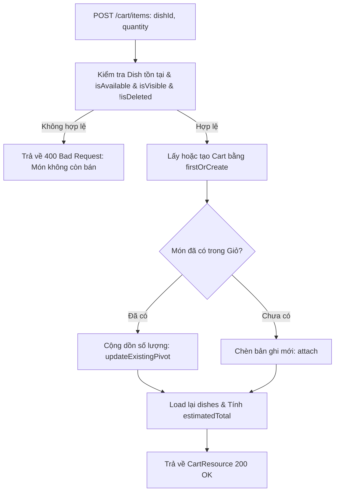

# 🛒 MODULE: CART – Business Logic & API Spec

> **Vị trí thư mục:** `app/Modules/Cart/`  
> **Namespace:** `App\Modules\Cart\`  
> **Phiên bản:** 2.0 (Streamlined Edition)

---

## 1. Tổng quan & Trách nhiệm

Module **Cart** quản lý giỏ hàng mua sắm quan hệ **1-1 với tài khoản** khách hàng (`GIO_HANG.ma_tai_khoan` là unique).
- Khởi tạo tự động bằng `Cart::firstOrCreate(['ma_tai_khoan' => $accountId])`.
- Thêm món (cộng dồn số lượng nếu đã có), cập nhật số lượng, xóa từng món, làm rỗng giỏ.
- **Lưu ý:** Module Cart không xử lý checkout; khi `OrderService` checkout thành công (`ORD-01`), nó sẽ gọi `$cart->dishes()->detach()` để làm rỗng giỏ.

---

## 2. Thành phần kỹ thuật

| Thành phần | Tên lớp / Đường dẫn file | Trách nhiệm |
| :--- | :--- | :--- |
| **Models** | `Cart` (`GIO_HANG`)<br>`CartItem` (`MON_AN_GIO_HANG`) | Model giỏ hàng và Pivot Model (quan hệ nhiều-nhiều qua `belongsToMany`). |
| **Service** | `Customer\CartService` | Logic thêm/sửa/xóa món và tính tổng tiền tạm tính. |
| **Controller**| `Customer\CartController` | Điều hướng 5 endpoints của giỏ hàng. |
| **Requests**  | `AddCartItemRequest`, `UpdateCartItemRequest` | Validate `dishId`, `quantity`. |
| **Resources** | `CartResource`, `CartItemResource` | Định dạng dữ liệu giỏ hàng trả về cho Frontend. |
| **Routes**    | `app/Modules/Cart/Routes/api.php` | Định tuyến `/api/v1/customer/cart/*` (Middleware: `auth:sanctum`, `role:CUSTOMER`). |

---

## 3. Domain Rules Bất Biến (Pivot BelongsToMany)

> [!WARNING]
> Bảng `MON_AN_GIO_HANG` có khóa chính phức hợp `PRIMARY KEY (ma_gio_hang, ma_mon_an)` và **không có cột `id` tự tăng**.  
> **TUYỆT ĐỐI KHÔNG** gọi lệnh `$item->save()` trên Model CartItem vì Eloquent sẽ sinh `WHERE id = NULL` gây crash.

**Quy tắc chuẩn sử dụng Pivot Methods:**
- Thêm món mới: `$cart->dishes()->attach($dishId, ['so_luong' => $qty])`.
- Cộng dồn số lượng: `$cart->dishes()->updateExistingPivot($dishId, ['so_luong' => $newQty])`.
- Xóa 1 món: `$cart->dishes()->detach($dishId)`.
- Làm rỗng giỏ: `$cart->dishes()->detach()`.

---

## 4. Schemas Dữ Liệu Chuẩn Dành Cho Frontend

### Schema 4.1: Chi Tiết Giỏ Hàng (`CartResource`)
```json
{
  "cartId": 10,
  "items": [
    {
      "dishId": 5,
      "dishName": "Gỏi ngó sen tôm thịt",
      "price": 85000,
      "quantity": 2,
      "itemTotal": 170000,
      "imageUrl": "https://example.com/images/goi-ngo-sen.jpg",
      "isAvailable": true
    }
  ],
  "totalItems": 1,
  "totalQuantity": 2,
  "estimatedTotal": 170000
}
```

---

## 5. Bảng Tổng Hợp 5 Endpoints Giỏ Hàng (Cart Endpoints)

| Mã API | Method | Endpoint URL | Body Request | Response Payload | Ghi chú nghiệp vụ |
| :---: | :---: | :--- | :--- | :--- | :--- |
| `CRT-01` | `GET` | `/api/v1/customer/cart` | *(Không)* | `200 OK`: `CartResource` (Schema 4.1) | Tự động tạo giỏ nếu chưa có |
| `CRT-02` | `POST` | `/api/v1/customer/cart/items` | `{ "dishId": int, "quantity": int >= 1 }` | `200 OK`: `CartResource` | Cộng dồn số lượng nếu món đã có sẵn |
| `CRT-03` | `PUT` | `/api/v1/customer/cart/items/{dishId}`| `{ "quantity": int >= 0 }` | `200 OK`: `CartResource` | Nếu `quantity = 0` $\rightarrow$ tự động xóa món khỏi giỏ |
| `CRT-04` | `DELETE`| `/api/v1/customer/cart/items/{dishId}`| *(Không)* | `200 OK`: `CartResource` | Xóa 1 món cụ thể qua `detach($dishId)` |
| `CRT-05` | `DELETE`| `/api/v1/customer/cart/clear` | *(Không)* | `200 OK`: `{ "message": "Cart cleared successfully" }` | Làm rỗng toàn bộ giỏ qua `detach()` |

---

## 6. Luồng Nghiệp Vụ Cốt Lõi (Thêm Món Vào Giỏ `CRT-02`)


