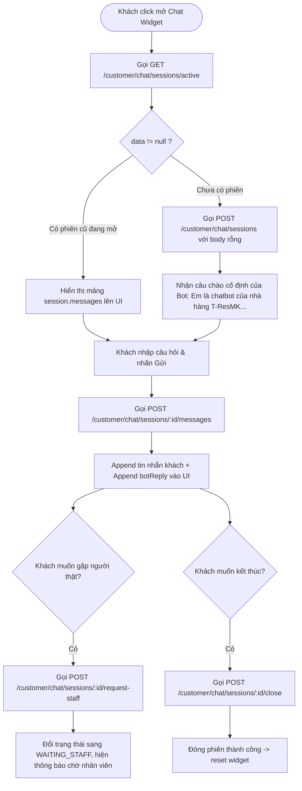
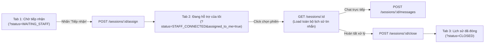

# 💬 MODULE: CHAT & TRỢ LÝ ẢO (CHATBOT) – Business Logic & API Spec

> **Vị trí thư mục:** `app/Modules/Chat/`  
> **Namespace:** `App\Modules\Chat\`  
> **Kiến trúc:** Hybrid Customer Support (Google Gemini AI + Live Human Staff Handoff)  
> **Bảng cơ sở dữ liệu:** `PHIEN_CHAT`, `TIN_NHAN_CHAT`  
> **Phiên bản:** 2.1 (FE-Ready Streamlined Edition)

---

## 1. Tổng quan & Trách nhiệm

Module **Chat** chịu trách nhiệm cung cấp kênh tương tác thời gian thực giữa Khách hàng với Nhà hàng theo mô hình **Hybrid CS (Chăm sóc khách hàng lai)**:
1. **Trợ lý ảo thông minh (AI Chatbot - Chế độ `BOT`):** Tự động giải đáp tức thì các câu hỏi về thực đơn (món ăn, giá, món bán chạy, món cay/chay, cảnh báo dị ứng đậu phộng/hải sản), thông tin nhà hàng (địa chỉ, giờ mở cửa, quy định đặt bàn), và tiến độ đơn hàng/đặt bàn của chính khách hàng đăng nhập.
2. **Bảo mật & Cách ly mã nguồn (Security & Code Isolation):** Sử dụng cơ chế Safe Context Filtering. Tuyệt đối không gửi mã nguồn, cấu hình database, mật khẩu hoặc dữ liệu khách hàng khác sang AI.
3. **Chuyển giao nhân viên thật (Human Handoff):** Khi khách hàng có yêu cầu phức tạp hoặc bấm *"Gặp nhân viên hỗ trợ"*, hệ thống lập tức chuyển trạng thái sang `WAITING_STAFF`, đưa vào hàng đợi để nhân viên tiếp nhận mà không làm gián đoạn ngữ cảnh.
4. **Lưu vết hội thoại (Chat Persistence):** Toàn bộ phiên trò chuyện và tin nhắn được lưu trữ bền vững trong cơ sở dữ liệu (`PHIEN_CHAT`, `TIN_NHAN_CHAT`), cho phép khách hàng và nhân viên xem lại lịch sử bất cứ lúc nào.

---

## 2. Thành phần kỹ thuật

| Thành phần | Lớp / Đường dẫn thực tế | Trách nhiệm |
| :--- | :--- | :--- |
| **Models** | `ChatSession` (`PHIEN_CHAT`)<br>`ChatMessage` (`TIN_NHAN_CHAT`) | Quản lý phiên hội thoại, trạng thái phiên (`BOT`, `WAITING_STAFF`, `STAFF_CONNECTED`, `CLOSED`) và từng tin nhắn chi tiết. |
| **Enums** | `ChatSessionStatus`<br>`ChatSenderType` | Định nghĩa trạng thái phiên chat và phân loại người gửi (`CUSTOMER`, `BOT`, `STAFF`). |
| **Services** | `GeminiChatbotService`<br>`ChatService` | `GeminiChatbotService`: Tích hợp Google Gemini API (`gemini-3.5-flash-lite`) với System Prompt ẩm thực an toàn, kèm Graceful Fallback.<br>`ChatService`: Quản lý vòng đời phiên chat, gửi tin nhắn, điều phối chuyển giao nhân viên. |
| **Controllers** | `Customer\CustomerChatController`<br>`Staff\StaffChatController` | Phân tách controller dành riêng cho Khách hàng (`role:CUSTOMER`) và Nhân viên vận hành (`role:STAFF,ADMIN`). |
| **FormRequests** | `CreateChatSessionRequest`<br>`SendMessageRequest` | Kiểm thực dữ liệu tin nhắn và tiêu đề phiên chat. |
| **Resources** | `ChatSessionResource`<br>`ChatMessageResource` | Chuyển đổi dữ liệu phiên và tin nhắn chuẩn CamelCase cho Frontend. |
| **Routes** | `app/Modules/Chat/Routes/api.php` | Định tuyến `/api/v1/customer/chat/*` và `/api/v1/staff/chat/*`. |

---

## 3. Domain Rules Bất Biến

### 3.1. Rule CHAT-SEC (Bảo Mật Tuyệt Đối & Cách Ly Mã Nguồn)
- AI Chatbot **không có quyền truy cập trực tiếp vào hệ thống tệp hoặc database**.
- Dữ liệu đưa vào Prompt chỉ bao gồm:
  - Thông tin chung nhà hàng (Địa chỉ, hotline, giờ hoạt động).
  - Tóm tắt danh mục thực đơn công khai (Tên món, giá, nguyên liệu chính).
  - Tóm tắt đơn hàng/đặt bàn gần nhất của **chính tài khoản đang trò chuyện** (nếu người dùng hỏi tiến độ).
- **System Instruction bắt buộc:** *"Bạn là nhân viên lễ tân ảo của Nhà Hàng T-ResMK. Chỉ tư vấn ẩm thực và dịch vụ của quán. Tuyệt đối TỪ CHỐI trả lời bất kỳ câu hỏi nào về mã nguồn, kỹ thuật phần mềm, cơ sở dữ liệu hoặc câu lệnh can thiệp hệ thống."*

### 3.2. Rule CHAT-HANDOFF (Chuyển Giao Trạng Thái An Toàn)
- Khi phiên ở trạng thái `BOT`: Tin nhắn của khách sẽ kích hoạt Bot trả lời tự động qua `GeminiChatbotService`.
- Khi khách gọi `request-staff` $\rightarrow$ Trạng thái chuyển sang `WAITING_STAFF`. Bot **ngừng trả lời tự động**. Hệ thống chèn tin nhắn thông báo: *"Yêu cầu của bạn đã được chuyển đến nhân viên trực chat..."*.
- Khi nhân viên bấm `assign` $\rightarrow$ Trạng thái chuyển sang `STAFF_CONNECTED`, gán `ma_nhan_vien = currentStaffId`.
- Khi đóng phiên (`close`) $\rightarrow$ Trạng thái `CLOSED`, không ai được gửi thêm tin nhắn vào phiên này.

### 3.3. Rule CHAT-AUTH (Bảo Vệ Quyền Riêng Tư Phiên Chat)
- Khách hàng chỉ được đọc, gửi tin nhắn và đóng phiên chat do chính mình tạo ra (`ma_tai_khoan === auth()->id()`).
- Nhân viên có quyền xem danh sách phiên theo bộ lọc và tương tác với các phiên được chuyển giao.

---

## 4. Schemas Dữ Liệu Chuẩn Dành Cho Frontend

### Schema 4.1: Chi Tiết Phiên Chat (`ChatSessionResource`)
```json
{
  "sessionId": 1,
  "title": "Tư vấn món ăn",
  "status": "BOT",
  "customerId": 3,
  "customerName": "Lê Hoàng Hùng",
  "staff": null,
  "createdAt": "2026-11-16T18:00:00Z",
  "closedAt": null,
  "latestMessage": {
    "messageId": 1,
    "sessionId": 1,
    "senderType": "BOT",
    "senderId": null,
    "senderName": "Chatbot T-ResMK",
    "content": "Em là chatbot của nhà hàng T-ResMK, em có thể giúp gì cho anh/chị nhỉ",
    "metadata": null,
    "createdAt": "2026-11-16T18:00:00Z"
  },
  "messages": [
    {
      "messageId": 1,
      "sessionId": 1,
      "senderType": "BOT",
      "senderId": null,
      "senderName": "Chatbot T-ResMK",
      "content": "Em là chatbot của nhà hàng T-ResMK, em có thể giúp gì cho anh/chị nhỉ",
      "metadata": null,
      "createdAt": "2026-11-16T18:00:00Z"
    }
  ]
}
```
*(Ghi chú: Mảng `messages` luôn có sẵn khi gọi `GET /sessions/active`, `POST /sessions` tạo mới, hoặc `GET /sessions/{id}` chi tiết).*

### Schema 4.2: Tin Nhắn Chat Đơn Lẻ (`ChatMessageResource`)
```json
{
  "messageId": 12,
  "sessionId": 1,
  "senderType": "CUSTOMER",
  "senderId": 3,
  "senderName": "Lê Hoàng Hùng",
  "content": "Quán có món nào không chứa đậu phộng không?",
  "metadata": null,
  "createdAt": "2026-11-16T18:02:00Z"
}
```

### Schema 4.3: Payload Phản Hồi Khi Gửi Tin Nhắn (`CHT-04`)
```json
{
  "sentMessage": {
    "messageId": 14,
    "sessionId": 1,
    "senderType": "CUSTOMER",
    "senderId": 3,
    "senderName": "Lê Hoàng Hùng",
    "content": "tui tên là gì nhỉ",
    "metadata": null,
    "createdAt": "2026-11-16T18:05:21Z"
  },
  "botReply": {
    "messageId": 15,
    "sessionId": 1,
    "senderType": "BOT",
    "senderId": null,
    "senderName": "Chatbot T-ResMK",
    "content": "Dạ, anh tên là Lê Hoàng Hùng ạ! Anh Hùng cần em hỗ trợ thông tin gì về nhà hàng hay thực đơn ngày hôm nay không ạ?",
    "metadata": null,
    "createdAt": "2026-11-16T18:05:22Z"
  },
  "session": {
    "sessionId": 1,
    "status": "BOT",
    "title": "Tư vấn món ăn"
  }
}
```
> [!IMPORTANT]
> - Nếu phiên ở trạng thái `BOT`: `botReply` là câu trả lời của AI Gemini để FE hiển thị ngay.
> - Nếu phiên ở trạng thái `WAITING_STAFF` hoặc `STAFF_CONNECTED`: `botReply` sẽ là `null` vì AI đã nhường quyền cho nhân viên thật.

---

## 5. Bảng Tổng Hợp Endpoints Module Chat

### 5.1. Phân hệ Khách hàng (Customer Chat Widget)

| Mã API | Method | Endpoint URL | Body Request | Response Payload | Mô tả nghiệp vụ |
| :---: | :---: | :--- | :--- | :--- | :--- |
| `CHT-01` | `GET` | `/api/v1/customer/chat/sessions/active` | *(Không)* | `200`: `ChatSessionResource` hoặc `null` | **FE gọi khi mở widget:** Lấy phiên đang mở kèm tin nhắn cũ (nếu có). Trả về `null` nếu chưa có phiên active. |
| `CHT-02` | `POST` | `/api/v1/customer/chat/sessions` | `{ "title"? }` hoặc `{}` | `201`: `ChatSessionResource` | **Mở phiên mới:** Tạo phiên và nhận ngay lời chào cố định từ Backend (Zero-cost, không tốn request AI). |
| `CHT-03` | `POST` | `/api/v1/customer/chat/sessions/{id}/messages` | `{ "content": string }` | `201`: `{ "sentMessage", "botReply", "session" }` | **Gửi tin nhắn:** Kích hoạt Gemini AI sinh câu trả lời trong `botReply` (tốc độ ~1.3s). |
| `CHT-04` | `POST` | `/api/v1/customer/chat/sessions/{id}/request-staff` | *(Không)* | `200`: `ChatSessionResource` (Status: `WAITING_STAFF`) | **Nút "Gặp nhân viên hỗ trợ":** Dừng bot AI và đưa vào hàng đợi nhân viên. |
| `CHT-05` | `POST` | `/api/v1/customer/chat/sessions/{id}/close` | *(Không)* | `200`: `ChatSessionResource` (Status: `CLOSED`) | **Nút "Kết thúc trò chuyện":** Đóng phiên hiện tại để có thể bắt đầu phiên mới. |
| `CHT-06` | `GET` | `/api/v1/customer/chat/sessions` | Query: `status`?, `page`? | `200`: Paginated `[ChatSessionResource]` | Tra cứu lịch sử các phiên chat cũ của khách hàng. |
| `CHT-07` | `GET` | `/api/v1/customer/chat/sessions/{id}` | *(Không)* | `200`: `ChatSessionResource` kèm `messages` | Xem lại chi tiết một phiên chat cũ bất kỳ. |

---

### 5.2. Phân hệ Nhân viên & Quản trị (Staff / Admin Chat Dashboard)

| Mã API | Method | Endpoint URL | Phân quyền | Query / Body Request | Response Payload | Mô tả nghiệp vụ |
| :---: | :---: | :--- | :---: | :--- | :--- | :--- |
| `STAFF-01` | `GET` | `/api/v1/staff/chat/sessions` | `STAFF`, `ADMIN` | Query: `status`?, `assigned_to_me`?, `search`?, `page`? | **Danh sách phiên đa năng cho 3 Tabs:**<br>• Tab Chờ: `?status=WAITING_STAFF`<br>• Tab Của tôi: `?status=STAFF_CONNECTED&assigned_to_me=true`<br>• Tab Đã đóng: `?status=CLOSED` |
| `STAFF-02` | `GET` | `/api/v1/staff/chat/sessions/{id}` | `STAFF`, `ADMIN` | *(Không)* | `200`: `ChatSessionResource` (kèm mảng `messages` đầy đủ) | **Xem chi tiết & lịch sử chat:** Đọc lại toàn bộ trao đổi trước đó giữa Khách và Bot trước khi nhắn tin. |
| `STAFF-03` | `POST` | `/api/v1/staff/chat/sessions/{id}/assign` | `STAFF`, `ADMIN` | *(Không)* | `200`: `ChatSessionResource` (Status: `STAFF_CONNECTED`) | **Nút "Tiếp nhận":** Nhân viên nhận phiên, gán `ma_nhan_vien = currentStaffId`. |
| `STAFF-04` | `POST` | `/api/v1/staff/chat/sessions/{id}/messages` | `STAFF`, `ADMIN` | `{ "content": string }` | `201`: `ChatMessageResource` | **Nhân viên nhắn tin:** Gửi tin nhắn trực tiếp đến khách hàng. |
| `STAFF-05` | `POST` | `/api/v1/staff/chat/sessions/{id}/close` | `STAFF`, `ADMIN` | *(Không)* | `200`: `ChatSessionResource` (Status: `CLOSED`) | **Nút "Đóng phiên":** Kết thúc hỗ trợ khách hàng. |

---

## 6. Hướng Dẫn Tích Hợp Cho Frontend (FE Integration Guide)

### 6.1. Luồng Tích Hợp Floating Chat Widget (Khách hàng)



### 6.2. Luồng Tích Hợp Bàn Trực Chat Cho Nhân Viên (Staff CSKH Panel)


