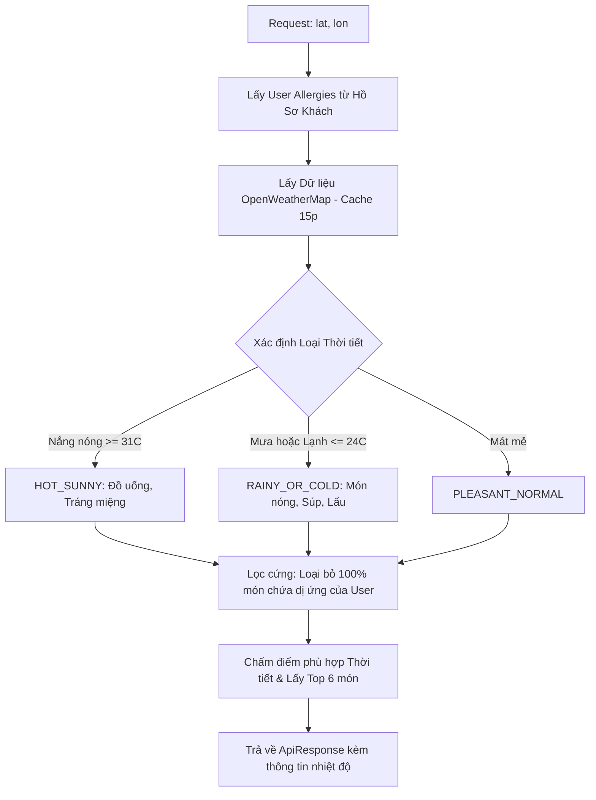

# 🥗 MODULE: MENU – Business Logic & API Spec

> **Vị trí thư mục:** `app/Modules/Menu/`  
> **Namespace:** `App\Modules\Menu\`  
> **Phiên bản:** 2.0 (Streamlined Edition)

---

## 1. Tổng quan & Trách nhiệm

Module **Menu** là trung tâm quản lý thực đơn của hệ thống nhà hàng:
- **Phía Khách hàng:** Lấy danh sách danh mục (Redis Cache), duyệt và tìm kiếm món ăn phân trang (lọc theo giá, dị ứng, danh mục), xem chi tiết món, nhận gợi ý món ăn theo thời tiết thực tế (OpenWeatherMap + lọc dị ứng).
- **Phía Quản trị:** Quản lý CRUD Danh mục và Món ăn, ẩn/hiện, xóa mềm bảo toàn toàn vẹn đơn hàng và cơ chế xóa bộ nhớ đệm tự động (Cache Busting).

---

## 2. Thành phần kỹ thuật

| Thành phần | Lớp / Đường dẫn thực tế | Trách nhiệm |
| :--- | :--- | :--- |
| **Models** | `Category` (`DANH_MUC`)<br>`Dish` (`MON_AN`) | Danh mục món ăn và chi tiết món ăn (cột `da_xoa`, `hien_thi`, `chat_di_ung`, `the_thoi_tiet`). |
| **Services** | `Customer\MenuService`<br>`Admin\CategoryService`<br>`Admin\DishService` | Truy vấn thực đơn, lọc thời tiết, CRUD danh mục/món ăn, xóa mềm và Cache Busting. |
| **Controllers** | `Customer\MenuController`<br>`Admin\CategoryController`<br>`Admin\DishController` | Tiếp nhận request và trả về chuẩn `ApiResponse`. |
| **FormRequests** | `Customer\WeatherRecommendationRequest`<br>`Admin\CreateCategoryRequest`<br>`Admin\CreateDishRequest`, `UpdateDishRequest`... | Kiểm thực dữ liệu đầu vào. |
| **Resources** | `CategoryResource`, `AdminCategoryResource`<br>`DishResource`, `DishDetailResource`, `AdminDishResource` | Chuẩn hóa dữ liệu JSON đầu ra cho Frontend. |
| **Routes** | `app/Modules/Menu/Routes/api.php` | Định tuyến `/api/v1/customer/*` và `/api/v1/admin/*`. |

---

## 3. Domain Rules Bất Biến

### 3.1. Chiến Lược Cache Redis & Cache Busting
- `menu:categories:active` (TTL 3600s): Danh sách danh mục đang bán. Admin thay đổi danh mục (`MNU-09`, `10`, `11`, `12`) $\rightarrow$ Gọi `Cache::forget('menu:categories:active')`.
- `weather_rec_{lat}_{lon}_{accountId}` (TTL 900s): Gợi ý món theo thời tiết. Tự hết hạn sau 15 phút.

### 3.2. Quy Tắc Xóa Mềm Món Ăn & Danh Mục
- **TUYỆT ĐỐI KHÔNG** gọi lệnh xóa vật lý `$dish->delete()`. Vi phạm ràng buộc khóa ngoại trong `CHI_TIET_DON_HANG`.
- **Luật Xóa mềm:** Luôn cập nhật cờ `$dish->update(['da_xoa' => true, 'hien_thi' => false])`.
- Khi xóa mềm danh mục: Tự động ẩn toàn bộ món thuộc danh mục đó.

---

## 4. Schemas Dữ Liệu Chuẩn Dành Cho Frontend

### Schema 4.1: Danh mục Món ăn (`CategoryResource`)
```json
{
  "categoryId": 1,
  "categoryName": "Khai vị",
  "description": "Các món gỏi, súp khai vị nhẹ nhàng",
  "isActive": true
}
```

### Schema 4.2: Món ăn Thu gọn (`DishResource` - Dùng cho Danh sách)
```json
{
  "dishId": 5,
  "dishName": "Gỏi ngó sen tôm thịt",
  "price": 85000,
  "imageUrl": "https://example.com/images/goi-ngo-sen.jpg",
  "isAvailable": true,
  "category": { "categoryId": 1, "categoryName": "Khai vị" }
}
```

### Schema 4.3: Chi Tiết Món ăn Đầy đủ (`DishDetailResource`)
```json
{
  "dishId": 5,
  "dishName": "Gỏi ngó sen tôm thịt",
  "price": 85000,
  "description": "Ngó sen tươi giòn trộn tôm sú và thịt ba chỉ",
  "imageUrl": "https://example.com/images/goi-ngo-sen.jpg",
  "isAvailable": true,
  "allergens": ["SHELLFISH", "PEANUT"],
  "weatherTags": ["HOT_SUNNY", "PLEASANT_NORMAL"],
  "category": { "categoryId": 1, "categoryName": "Khai vị" }
}
```

---

## 5. Bảng Tổng Hợp Endpoints CRUD Chuẩn

### 5.1. Nhóm API Danh Mục Thực Đơn (Category Endpoints)
| Mã API | Method | Endpoint URL | Phân quyền | Body Request | Response Payload | Mã HTTP |
| :---: | :---: | :--- | :---: | :--- | :--- | :---: |
| `MNU-01` | `GET` | `/api/v1/customer/categories` | Public | *(Không)* | Danh sách `[CategoryResource]` (Redis Cache 3600s) | `200` |
| `MNU-09` | `POST` | `/api/v1/admin/categories` | `ADMIN` | `{ "categoryName", "description"? }` | `CategoryResource` mới tạo (Busting Cache) | `201 / 422` |
| `MNU-10` | `PUT` | `/api/v1/admin/categories/{id}` | `ADMIN` | `{ "categoryName", "description"? }` | `CategoryResource` đã sửa (Busting Cache) | `200 / 404` |
| `MNU-11` | `PATCH`| `/api/v1/admin/categories/{id}/visibility` | `ADMIN` | `{ "isVisible": boolean }` | `CategoryResource` cập nhật cờ ẩn/hiện | `200 / 404` |
| `MNU-12` | `DELETE`| `/api/v1/admin/categories/{id}` | `ADMIN` | *(Không)* | `{ "message": "Xóa mềm danh mục thành công" }` | `200 / 404` |

### 5.2. Nhóm API Món Ăn (Dish Endpoints)
| Mã API | Method | Endpoint URL | Phân quyền | Body / Query Request | Response Payload | Mã HTTP |
| :---: | :---: | :--- | :---: | :--- | :--- | :---: |
| `MNU-02` | `GET` | `/api/v1/customer/dishes` | Public | Query: `page`, `perPage`, `categoryId` | Paginated `[DishResource]` | `200` |
| `MNU-03` | `GET` | `/api/v1/customer/dishes/search` | Public | Query: `q`, `minPrice`, `maxPrice`, `excludeAllergens[]` | Paginated `[DishResource]` | `200` |
| `MNU-07` | `GET` | `/api/v1/customer/dishes/{id}` | Public | *(Không)* | `DishDetailResource` (Schema 4.3) | `200 / 404` |
| `MNU-08` | `GET` | `/api/v1/admin/dishes` | `ADMIN` | Query: `page`, `search`, `categoryId`, `includeDeleted` | Paginated `[AdminDishResource]` | `200` |
| `MNU-13` | `POST` | `/api/v1/admin/dishes` | `ADMIN` | `{ "dishName", "price", "categoryId", "description"?, "imageUrl"?, "allergens"?, "weatherTags"? }` | `201`: `DishDetailResource` mới tạo | `201 / 422` |
| `MNU-14` | `PUT` | `/api/v1/admin/dishes/{id}` | `ADMIN` | Body tương tự `POST` | `DishDetailResource` đã cập nhật | `200 / 404` |
| `MNU-15` | `PATCH`| `/api/v1/admin/dishes/{id}/availability` | `ADMIN` | `{ "isAvailable": boolean }` | Đánh dấu còn hoặc hết món | `200 / 404` |
| `MNU-16` | `DELETE`| `/api/v1/admin/dishes/{id}` | `ADMIN` | *(Không)* | `{ "message": "Xóa mềm món ăn thành công" }` | `200 / 404` |

---

## 6. Use Case Nghiệp Vụ Phức Tạp (Complex Use Case)

### UC MNU-04: Gợi Ý Món Ăn Theo Thời Tiết Thực Tế & Lọc Dị Ứng Cứng
- **Actor:** Khách hàng (Đã đăng nhập hoặc Vãng lai).
- **Endpoint:** `GET /api/v1/customer/dishes/recommendations/weather?lat=10.76&lon=106.66`
- **Validation:** `lat`: `required|numeric|between:-90,90`, `lon`: `required|numeric|between:-180,180`.
- **Luồng thực thi gợi ý theo thời tiết:**
  1. **Lấy danh sách chất dị ứng:** Nếu có Sanctum Token, lấy mảng `allergies` từ `UserProfile`. Nếu là khách vãng lai, mảng dị ứng là rỗng.
  2. **Truy vấn Thời tiết:** Kiểm tra cache `weather_{lat}_{lon}` (TTL 900s). Nếu miss, gọi OpenWeatherMap API lấy nhiệt độ $T$ và thời tiết chính.
  3. **Phân loại thời tiết:**
     - $T \ge 31^\circ\text{C}$ & không mưa: `HOT_SUNNY` $\rightarrow$ Ưu tiên Đồ uống, Tráng miệng, Khai vị mát.
     - $T \le 24^\circ\text{C}$ hoặc có mưa/bão: `RAINY_OR_COLD` $\rightarrow$ Ưu tiên Món chính nóng, Lẩu, Súp, Nướng.
     - Còn lại: `PLEASANT_NORMAL`.
  4. **Lọc Cứng Dị Ứng (Strict Allergen Exclusion):**
     ```php
     $safeDishes = $activeDishes->reject(function ($dish) use ($userAllergies) {
         return count(array_intersect($dish->allergens ?? [], $userAllergies)) > 0;
     });
     ```
  5. **Chấm điểm & Sắp xếp:** Món có category ưu tiên (+10 điểm), món có `weatherTag` khớp (+20 điểm). Lấy top 6 món cao điểm nhất.
- **Sơ đồ luồng thực thi (Mermaid):**

- **Response mẫu `200 OK`:**
  ```json
  {
    "success": true, "code": 200, "message": "Weather recommendations retrieved successfully",
    "data": {
      "weather": { "temperatureCelsius": 33.5, "condition": "HOT_SUNNY" },
      "excludedAllergens": ["SHELLFISH"],
      "recommendedDishes": [
        { "dishId": 12, "dishName": "Trà đào cam sả", "price": 45000, "isAvailable": true }
      ]
    }
  }
  ```
