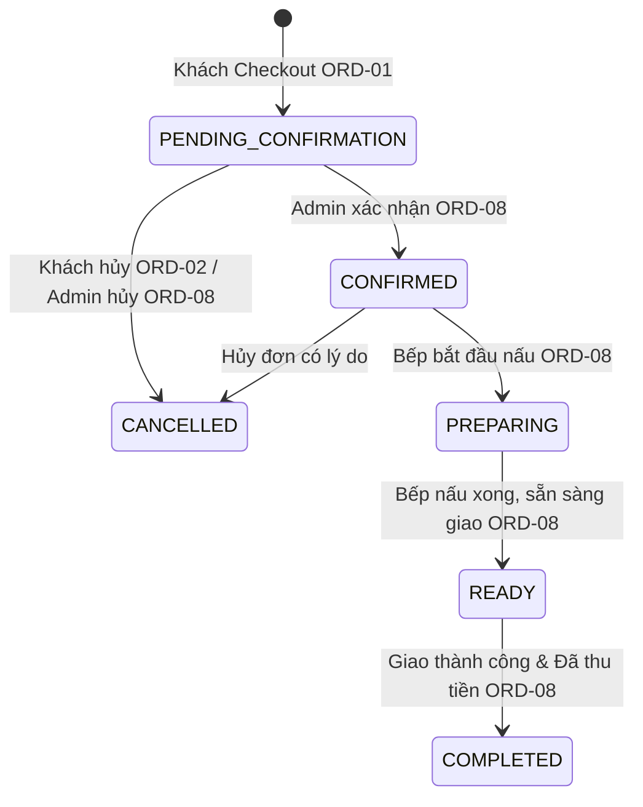

# 📦 MODULE: ORDER – Business Logic & API Spec

> **Vị trí thư mục:** `app/Modules/Order/`  
> **Namespace:** `App\Modules\Order\`  
> **Phiên bản:** 2.0 (Streamlined Edition)

---

## 1. Tổng quan & Trách nhiệm

Module **Order** quản lý toàn bộ quy trình vận hành đơn hàng của nhà hàng:
- **Checkout:** Chuyển đổi giỏ hàng thành đơn hàng chính thức (`DB::transaction`), chốt snapshot đơn giá tại thời điểm đặt.
- **Chống Race Condition:** Áp dụng Redis Distributed Lock `lock:order:checkout:{accountId}` trong 10 giây chống double-click.
- **FSM Trạng thái:** Điều hành máy trạng thái đơn hàng qua 5 bước nghiêm ngặt.
- **Đồng bộ Thanh toán:** Tự động cập nhật `PAID` cho tiền mặt khi hoàn thành, chặn hoàn thành nếu chuyển khoản QR chưa thanh toán.

---

## 2. Thành phần kỹ thuật

| Thành phần | Lớp / Đường dẫn thực tế | Trách nhiệm |
| :--- | :--- | :--- |
| **Models** | `Order` (`DON_HANG`)<br>`OrderItem` (`CHI_TIET_DON_HANG`) | Model đơn hàng và Pivot chi tiết món (lưu snapshot `don_gia`). |
| **Services** | `Customer\OrderService`<br>`Admin\OrderService` | Xử lý checkout khóa Redis, hủy đơn, FSM trạng thái và đồng bộ thanh toán. |
| **Controllers**| `Customer\OrderController`<br>`Admin\OrderController` | Tiếp nhận request và trả về chuẩn `ApiResponse`. |
| **Requests**  | `CheckoutOrderRequest`, `CancelOrderRequest`<br>`UpdateOrderStatusRequest` | Kiểm thực thông tin checkout, lý do hủy và trạng thái đích. |
| **Resources** | `OrderResource`, `OrderItemResource`<br>`OrderPaymentResource`, `AdminOrderResource` | Định dạng dữ liệu đơn hàng và chi tiết thanh toán cho Frontend. |
| **Routes**    | `app/Modules/Order/Routes/api.php` | Định tuyến `/api/v1/customer/orders/*` và `/api/v1/admin/orders/*`. |

---

## 3. Máy Trạng Thái Đơn Hàng (Order FSM) & Domain Rules

### 3.1. Sơ Đồ Chuyển Đổi Trạng Thái


### 3.2. Bảng Ma Trận Chuyển Trạng Thái Hợp Lệ
| Trạng thái hiện tại | Trạng thái tiếp theo cho phép | Điều kiện tiên quyết & Hành động đồng bộ |
| :--- | :--- | :--- |
| `PENDING_CONFIRMATION` | `CONFIRMED`, `CANCELLED` | Khách chỉ được tự hủy khi đang ở trạng thái này (`ORD-02`). |
| `CONFIRMED` | `PREPARING`, `CANCELLED` | Admin chuyển sang chế biến. |
| `PREPARING` | `READY`, `CANCELLED` | Món đã nấu xong. |
| `READY` | `COMPLETED` | **Đồng bộ Thanh toán:**<br>- Nếu `CASH`: tự động cập nhật `Payment.trang_thai = PAID`.<br>- Nếu `BANK_TRANSFER_QR`: nếu Payment chưa `PAID` $\rightarrow$ chặn và báo lỗi 400. |
| `COMPLETED` / `CANCELLED`| *(Trạng thái cuối - Terminal)*| Bất biến, không được phép chuyển trạng thái nữa. |

### 3.3. Quy Tắc Khóa Phân Tán Redis (Distributed Lock)
- Key: `lock:order:checkout:{accountId}`, TTL 10 giây.
- Sử dụng callback `Cache::lock($key, 10)->block(5, function () { ... })` đảm bảo luôn giải phóng lock trong mọi tình huống, tránh Deadlock nếu phát sinh lỗi.
- Người dùng bấm đúp sẽ nhận lỗi `429 Too Many Requests`.

---

## 4. Schema Dữ Liệu Chuẩn Dành Cho Frontend (`OrderResource`)

```json
{
  "orderId": 105,
  "orderDate": "2026-11-10 12:30:00",
  "totalAmount": 170000,
  "status": "PENDING_CONFIRMATION",
  "shippingAddress": "[DELIVERY] Nguyễn Văn A - 0901234567 | 123 Lê Duẩn, Q.1",
  "items": [
    {
      "dishId": 5,
      "dishName": "Gỏi ngó sen tôm thịt",
      "quantity": 2,
      "unitPrice": 85000,
      "itemTotal": 170000
    }
  ],
  "payment": {
    "paymentId": 50,
    "method": "TIEN_MAT",
    "status": "CHUA_THANH_TOAN",
    "amount": 170000
  }
}
```

---

## 5. Bảng Tổng Hợp Endpoints Đơn Hàng

| Mã API | Method | Endpoint URL | Phân quyền | Body / Query Request | Response Payload | Mã HTTP |
| :---: | :---: | :--- | :---: | :--- | :--- | :---: |
| `ORD-02` | `PUT` | `/api/v1/customer/orders/{id}/cancel` | `CUSTOMER` | `{ "cancelReason": string }` | `OrderResource` (Status `CANCELLED`) | `200 / 409` |
| `ORD-04` | `GET` | `/api/v1/customer/orders` | `CUSTOMER` | Query: `page`, `status` | Paginated `[OrderResource]` | `200` |
| `ORD-05` | `GET` | `/api/v1/customer/orders/{id}` | `CUSTOMER` | *(Không)* | `OrderResource` chi tiết | `200 / 404` |
| `ORD-06` | `GET` | `/api/v1/admin/orders` | `ADMIN` | Query: `page`, `status`, `date` | Paginated `[AdminOrderResource]` | `200` |
| `ORD-07` | `GET` | `/api/v1/admin/orders/{id}` | `ADMIN` | *(Không)* | `AdminOrderResource` chi tiết | `200 / 404` |

---

## 6. Use Cases Nghiệp Vụ Phức Tạp (Complex Use Cases)

### UC ORD-01: Checkout Đặt Hàng Từ Giỏ Hàng (Redis Lock + Transaction)
- **Actor:** Khách hàng (`CUSTOMER`).
- **Endpoint:** `POST /api/v1/customer/orders/checkout`
- **Validation:**
  - `fulfillmentType`: `required|in:DELIVERY,PICKUP`
  - `recipientName`: `required|string|max:100`
  - `recipientPhone`: `required|regex:/^0[0-9]{9}$/`
  - `shippingAddress`: `required_if:fulfillmentType,DELIVERY|string`
  - `paymentMethod`: `required|in:CASH,BANK_TRANSFER_QR`
- **Luồng thực thi 7 bước (Bọc trong `Cache::lock` & `DB::transaction`):**
  1. **Khóa Redis:** Khóa `lock:order:checkout:{accountId}` trong 10s. Nếu đang bận ném `429 Too Many Requests`.
  2. **Khóa bản ghi Giỏ:** `Cart::where('ma_tai_khoan', $id)->lockForUpdate()->first()`. Nếu giỏ rỗng ném `400 Bad Request`.
  3. **Kiểm tra trạng thái món & Snapshot giá:** Duyệt qua các món trong giỏ. Nếu món bị xóa/hết hàng ném `400 Bad Request`. Chốt cứng snapshot `don_gia = $dish->gia_tien`.
  4. **Tạo Đơn Hàng:** Tạo bản ghi `DON_HANG` với trạng thái `PENDING_CONFIRMATION` và địa chỉ giao hàng chuẩn hóa.
  5. **Lưu Chi Tiết Món:** Gọi `$order->dishes()->attach($pivotData)` lưu `so_luong` và `don_gia`.
  6. **Khởi tạo Thanh toán:** Tạo bản ghi `THANH_TOAN` tương ứng với trạng thái `UNPAID`.
  7. **Làm rỗng giỏ:** Gọi `$cart->dishes()->detach()`.
- **Response `201 Created`:** `OrderResource` (Schema 4).

---

### UC ORD-08: Cập Nhật Trạng Thái Quy Trình Đơn Hàng (Admin/Bếp)
- **Actor:** Quản trị viên (`ADMIN`).
- **Endpoint:** `PATCH /api/v1/admin/orders/{id}/status`
- **Validation:** `targetStatus`: `required|string|in:CONFIRMED,PREPARING,READY,COMPLETED,CANCELLED`, `cancelReason` (required nếu hủy).
- **Luồng thực thi:**
  1. Kiểm tra trạng thái hiện tại đối chiếu với Ma trận FSM ở mục 3.2. Nếu bước chuyển không hợp lệ ném `400 Bad Request`.
  2. Nếu chuyển sang `COMPLETED`:
     - Nếu `phuong_thuc === 'Tiền mặt'`: tự động cập nhật `Payment.trang_thai = PAID`.
     - Nếu `phuong_thuc === 'Chuyển khoản'` mà `Payment.trang_thai !== PAID`: ném `400 Bad Request` (*"Chưa thanh toán QR"*).
  3. Cập nhật trạng thái và trả về `AdminOrderResource`.
