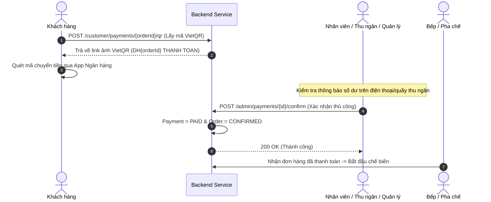

# 💳 MODULE: PAYMENT – Business Logic & API Spec

> **Vị trí thư mục:** `app/Modules/Payment/`  
> **Namespace:** `App\Modules\Payment\`  
> **Phiên bản:** 2.0 (Streamlined Edition)

---

## 1. Tổng quan & Trách nhiệm

Module **Payment** quản lý toàn bộ chu trình thanh toán của đơn hàng:
- Quan hệ 1-1 chặt chẽ với đơn hàng (`ma_don_hang` là UNIQUE FK).
- Sinh mã QR chuyển khoản chuẩn quốc gia **VietQR Napas 247** kèm số tiền và cú pháp `DH{orderId} THANH TOAN`.
- **Mô hình vận hành tinh gọn:** Khách quét VietQR chuyển khoản vào tài khoản nhà hàng, Nhân viên hoặc Quản lý kiểm tra biến động số dư và **xác nhận thanh toán thủ công bằng tay (Manual Confirmation)** trên hệ thống POS/Admin.
- Hỗ trợ Mock thanh toán nhanh cho Frontend và Webhook dự phòng.
- Quản lý đối soát lệch tiền (Reconciliation) và hoàn tiền (Refund) cho Admin.

---

## 2. Thành phần kỹ thuật

| Thành phần | Lớp / Đường dẫn thực tế | Trách nhiệm |
| :--- | :--- | :--- |
| **Model** | `Payment` (`THANH_TOAN`) | Model thanh toán: `so_tien`, `phuong_thuc`, `trang_thai`, `ma_giao_dich`, `log_callback`. |
| **Services** | `Customer\PaymentService`<br>`Admin\PaymentService` | Sinh mã VietQR, kiểm tra trạng thái real-time, xác nhận thủ công bởi nhân viên, đối soát và hoàn tiền. |
| **Controllers**| `Customer\PaymentController`<br>`Admin\PaymentController` | Điều hướng API thanh toán khách hàng và quản trị xác nhận giao dịch của Nhân viên / Quản trị viên. |
| **Requests**  | `ReconcilePaymentRequest`, `RefundPaymentRequest` | Kiểm thực dữ liệu đối soát và lý do hoàn tiền. |
| **Resources** | `AdminPaymentResource`, `CallbackLogResource` | Chuẩn hóa dữ liệu giao dịch cho Frontend. |
| **Routes**    | `app/Modules/Payment/Routes/api.php` | Định tuyến `/api/v1/customer/payments/*` và `/api/v1/admin/payments/*`. |

---

## 3. Domain Rules Bất Biến

### 3.1. Chuẩn Sinh Mã VietQR Napas 247
- Cú pháp nội dung chuyển khoản bắt buộc: `DH{orderId} THANH TOAN` (ví dụ `DH105 THANH TOAN`).
- URL sinh ảnh VietQR chuẩn:
  ```text
  https://img.vietqr.io/image/{bankBin}-{accountNumber}-compact2.png?amount={amount}&addInfo=DH{orderId}%20THANH%20TOAN
  ```

### 3.2. Quy Trình Xác Nhận Thanh Toán Thủ Công (Staff Manual Confirmation)
- Khách hàng quét mã VietQR và thực hiện chuyển tiền từ app ngân hàng.
- Thu ngân / Nhân viên / Quản lý kiểm tra thông báo biến động số dư trên thiết bị cửa hàng.
- Nhân viên gọi API `POST /api/v1/admin/payments/{id}/confirm` hoặc `POST /api/v1/admin/orders/{orderId}/confirm-payment`.
- Hệ thống cập nhật:
  1. `Payment.trang_thai = PAID` (`Đã thanh toán`).
  2. Gán mã giao dịch nội bộ `MANUAL-...` và lưu vết log nhân viên xác nhận (`log_callback`).
  3. Tự động đồng bộ `Order.trang_thai = CONFIRMED` (nếu đang ở `PENDING_CONFIRMATION`).
- Cho phép bếp bắt đầu chế biến và đơn hàng có thể chuyển tiếp sang các trạng thái `PREPARING -> READY -> COMPLETED`.

---

## 4. Schemas Dữ Liệu Chuẩn Dành Cho Frontend

### Schema 4.1: Thông Tin Thanh Toán VietQR (`CustomerQrResponse`)
```json
{
  "orderId": 105,
  "amount": 170000,
  "paymentMethod": "BANK_TRANSFER_QR",
  "status": "UNPAID",
  "qrImageUrl": "https://img.vietqr.io/image/970436-1029384756-compact2.png?amount=170000&addInfo=DH105%20THANH%20TOAN",
  "transferContent": "DH105 THANH TOAN",
  "expiresAt": "2026-11-20T19:15:00+07:00"
}
```

### Schema 4.2: Chi Tiết Giao Dịch Admin (`AdminPaymentResource`)
```json
{
  "paymentId": 50,
  "orderId": 105,
  "amount": 170000,
  "paymentMethod": "BANK_TRANSFER_QR",
  "status": "PAID",
  "transactionCode": "MANUAL-6739A1B2",
  "orderDate": "2026-11-20T19:00:00",
  "customerName": "Nguyễn Văn A",
  "customerPhone": "0901234567"
}
```

---

## 5. Bảng Tổng Hợp Endpoints Thanh Toán

| Mã API | Method | Endpoint URL | Phân quyền | Body / Query Request | Response Payload | Mã HTTP |
| :---: | :---: | :--- | :---: | :--- | :--- | :---: |
| `PAY-01` | `POST`| `/api/v1/customer/payments/{orderId}/qr` | `CUSTOMER` | *(Không)* | `CustomerQrResponse` (Schema 4.1) | `200 / 404` |
| `PAY-02` | `GET` | `/api/v1/customer/payments/{orderId}/status` | `CUSTOMER` | *(Không)* | `{ "status": "PAID", "isPaid": true }` | `200` |
| `PAY-03` | `POST`| `/api/v1/admin/payments/{id}/confirm` | `ADMIN,STAFF` | `{ "note"?: string }` | Xác nhận thanh toán thủ công bởi Nhân viên/Quản lý | `200 / 400 / 404` |
| `PAY-04` | `GET` | `/api/v1/admin/payments` | `ADMIN,STAFF` | Query: `page`, `status`, `method`, `search` | Paginated `[AdminPaymentResource]` | `200` |
| `PAY-05` | `POST`| `/api/v1/admin/payments/{id}/refund` | `ADMIN,STAFF` | `{ "refundReason": string }` | Hoàn tiền giao dịch & Tự hủy đơn hàng | `200 / 400` |
| `PAY-06` | `POST`| `/api/v1/admin/payments/reconcile` | `ADMIN,STAFF` | `{ "orderId"?: int, "paymentId"?: int }` | Báo cáo đối soát doanh thu | `200` |
| `PAY-07` | `POST`| `/api/v1/customer/payments/webhook` | Public | Webhook payload (dự phòng) | Tự động xử lý nếu có webhook | `200 / 400` |
| `PAY-08` | `POST`| `/api/v1/customer/payments/{orderId}/mock-payment` | `CUSTOMER` | *(Không)* | Mock thanh toán thành công (dành cho FE test) | `200 / 400 / 404` |

---

## 6. Sơ Đồ Quy Trình Xác Nhận Thanh Toán Thủ Công (Mermaid)


