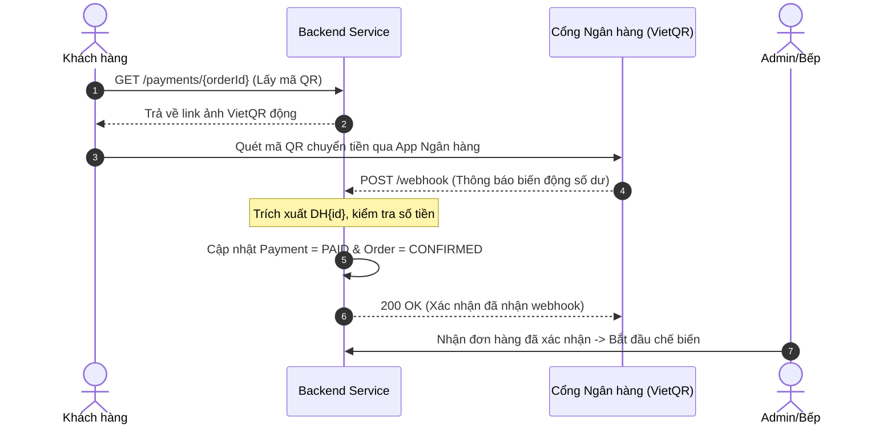

# 💳 MODULE: PAYMENT – Business Logic & API Spec

> **Vị trí thư mục:** `app/Modules/Payment/`  
> **Namespace:** `App\Modules\Payment\`  
> **Phiên bản:** 2.0 (Streamlined Edition)

---

## 1. Tổng quan & Trách nhiệm

Module **Payment** quản lý toàn bộ chu trình thanh toán của đơn hàng:
- Quan hệ 1-1 chặt chẽ với đơn hàng (`ma_don_hang` là UNIQUE FK).
- Sinh mã QR động chuẩn quốc gia **VietQR Napas 247** kèm số tiền và cú pháp `DH{orderId} THANH TOAN`.
- Tiếp nhận Webhook biến động số dư ngân hàng và tự động cập nhật trạng thái đơn hàng.
- Quản lý đối soát lệch tiền (Reconciliation) và hoàn tiền (Refund) cho Admin.

---

## 2. Thành phần kỹ thuật

| Thành phần | Lớp / Đường dẫn thực tế | Trách nhiệm |
| :--- | :--- | :--- |
| **Model** | `Payment` (`THANH_TOAN`) | Model thanh toán: `so_tien`, `phuong_thuc`, `trang_thai`, `ma_giao_dich`, `log_callback`. |
| **Services** | `Customer\PaymentService`<br>`Admin\PaymentService` | Sinh mã VietQR, kiểm tra trạng thái real-time, xử lý Webhook đối soát và hoàn tiền. |
| **Controllers**| `Customer\PaymentController`<br>`Admin\PaymentController` | Điều hướng API thanh toán khách hàng và quản trị giao dịch Admin. |
| **Requests**  | `ReconcilePaymentRequest`, `RefundPaymentRequest` | Kiểm thực dữ liệu đối soát và lý do hoàn tiền. |
| **Resources** | `AdminPaymentResource`, `CallbackLogResource` | Chuẩn hóa dữ liệu giao dịch cho Frontend. |
| **Routes**    | `app/Modules/Payment/Routes/api.php` | Định tuyến `/api/v1/customer/payments/*` và `/api/v1/admin/payments/*`. |

---

## 3. Domain Rules Bất Biến

### 3.1. Chuẩn Sinh Mã VietQR Napas 247
- Cú pháp nội dung chuyển khoản bắt buộc: `DH{orderId} THANH TOAN` (ví dụ `DH105 THANH TOAN`).
- URL sinh ảnh VietQR chuẩn:
  ```text
  https://img.vietqr.io/image/{bankBin}-{accountNumber}-compact2.png?amount={amount}&addInfo=DH{orderId}%20THANH%20TOAN
  ```

### 3.2. Luồng Thực Thi Webhook Đối Soát Tự Động
- Tiếp nhận payload từ cổng ngân hàng (SePay / PayOS).
- Trích xuất `orderId` từ nội dung giao dịch bằng biểu thức chính quy: `/DH(\d+)/i`.
- Kiểm tra số tiền chuyển: `so_tien_nhan >= order->tong_tien`.
- Nếu hợp lệ: Cập nhật `Payment.trang_thai = PAID` và tự động chuyển `Order.trang_thai = CONFIRMED`.
- Lưu trữ raw JSON vào cột `log_callback` để phục vụ đối soát.

---

## 4. Schemas Dữ Liệu Chuẩn Dành Cho Frontend

### Schema 4.1: Thông Tin Thanh Toán VietQR (`CustomerQrResponse`)
```json
{
  "orderId": 105,
  "amount": 170000,
  "paymentMethod": "CHUYEN_KHOAN",
  "status": "CHUA_THANH_TOAN",
  "qrCodeUrl": "https://img.vietqr.io/image/970422-123456789-compact2.png?amount=170000&addInfo=DH105%20THANH%20TOAN",
  "bankInfo": {
    "bankName": "MBBank",
    "accountNumber": "123456789",
    "accountName": "NHA HANG HUONG SEN",
    "transferContent": "DH105 THANH TOAN"
  }
}
```

### Schema 4.2: Chi Tiết Giao Dịch Admin (`AdminPaymentResource`)
```json
{
  "paymentId": 50,
  "orderId": 105,
  "amount": 170000,
  "paymentMethod": "CHUYEN_KHOAN",
  "status": "DA_THANH_TOAN",
  "transactionCode": "FT26110098231",
  "orderDate": "2026-11-10 12:30:00",
  "customer": { "fullName": "Nguyễn Văn A", "phoneNumber": "0901234567" }
}
```

---

## 5. Bảng Tổng Hợp Endpoints Thanh Toán

| Mã API | Method | Endpoint URL | Phân quyền | Body / Query Request | Response Payload | Mã HTTP |
| :---: | :---: | :--- | :---: | :--- | :--- | :---: |
| `PAY-04` | `GET` | `/api/v1/customer/payments/{orderId}` | `CUSTOMER` | *(Không)* | `CustomerQrResponse` (Schema 4.1) | `200 / 404` |
| `PAY-06` | `GET` | `/api/v1/customer/payments/{orderId}/status` | `CUSTOMER` | *(Không)* | `{ "status": "DA_THANH_TOAN", "isPaid": true }` | `200` |
| `PAY-07` | `POST`| `/api/v1/customer/payments/webhook` | Public | Webhook payload từ cổng thanh toán | `{ "success": true, "message": "Webhook processed" }` | `200 / 400` |
| `PAY-01` | `GET` | `/api/v1/admin/payments` | `ADMIN` | Query: `page`, `status`, `method`, `date` | Paginated `[AdminPaymentResource]` | `200` |
| `PAY-02` | `GET` | `/api/v1/admin/payments/{id}` | `ADMIN` | *(Không)* | `AdminPaymentResource` chi tiết | `200 / 404` |
| `PAY-03` | `PATCH`| `/api/v1/admin/payments/{id}/confirm` | `ADMIN` | *(Không)* | Xác nhận đã thu tiền mặt tại quầy | `200 / 400` |
| `PAY-05` | `POST`| `/api/v1/admin/payments/{id}/refund` | `ADMIN` | `{ "refundReason": string }` | Hoàn tiền giao dịch & Tự hủy đơn hàng | `200 / 400` |

---

## 6. Sơ Đồ Quy Trình Thanh Toán & Webhook (Mermaid)


